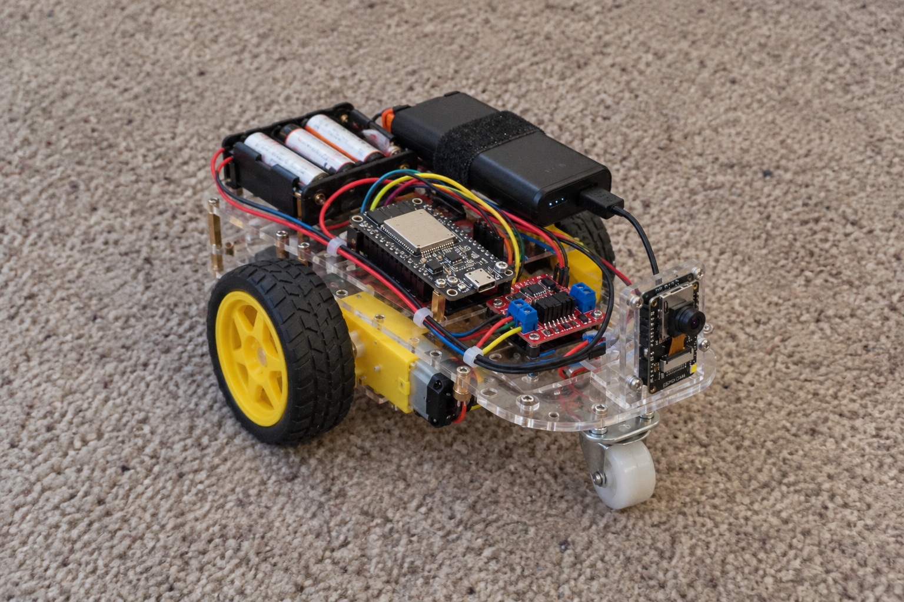

# pragRover

Buliding an ESP32 rover. Connecting [pragYantra](https://github.com/sriramsme/pragYantra) to this robot so that I can drive it from my phone through [Pickle](https://github.com/sriramsme/pickle) and Tailscale. It's like a pet that I can eventaully make it capable to follow and navigate, get simple errands done

*Concept image, building this lil guy.*

Python runs on the laptop/raspberry-pi etc. C firmware handles the motors and encoders on one ESP32, and the camera on an ESP32-CAM.

## Run

Requires Python 3.12 and uv.

```bash
uv sync --locked --all-extras
uv run prag-rover --no-env --json demo
uv run prag-rover --no-env session --simulated
```

In another terminal, from the same directory:

```bash
uv run prag-rover arm
uv run prag-rover move 0.10
uv run prag-rover jobs
uv run prag-rover stop
```

Check `jobs` for completion. Arm again before the next movement. `turn 15`,
`inspect --describe`, `capture` and `shutdown` are also available.
The offline demo uses fake model responses and needs no API keys.

## Firmware

The tool scripts use ESP-IDF 5.5.2.

```bash
./tools/setup-idf.sh
./tools/idf.sh -C firmware/motion_controller menuconfig
./tools/idf.sh -C firmware/motion_controller build
./tools/idf.sh -C firmware/camera_node menuconfig
./tools/idf.sh -C firmware/camera_node build
```

Set the GPIOs to match the wiring and enter measured wheel calibration.
Physical I/O starts disabled. The motor driver needs a controllable nSLEEP pin.

Copy `.env.example` to `.env` and set the secrets configured on the boards.
Use their LAN addresses:

```bash
uv run prag-rover session --controller 192.168.1.40:8765 \
  --camera-url http://192.168.1.41/capture
```

The board connections are unencrypted, so keep them on a trusted LAN.
`--live` opts into paid OpenAI calls. `--interpret typesafe` opts into Jev.
Models don't directly control the motors.

PragYantra's current source snapshot is in [vendor/](vendor/README.md).
[GPLv3](LICENSE).
